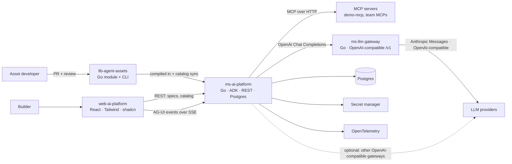
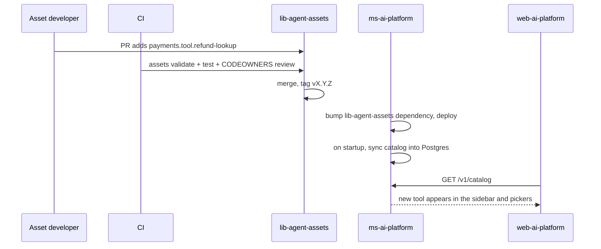
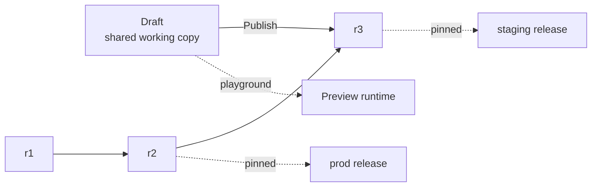
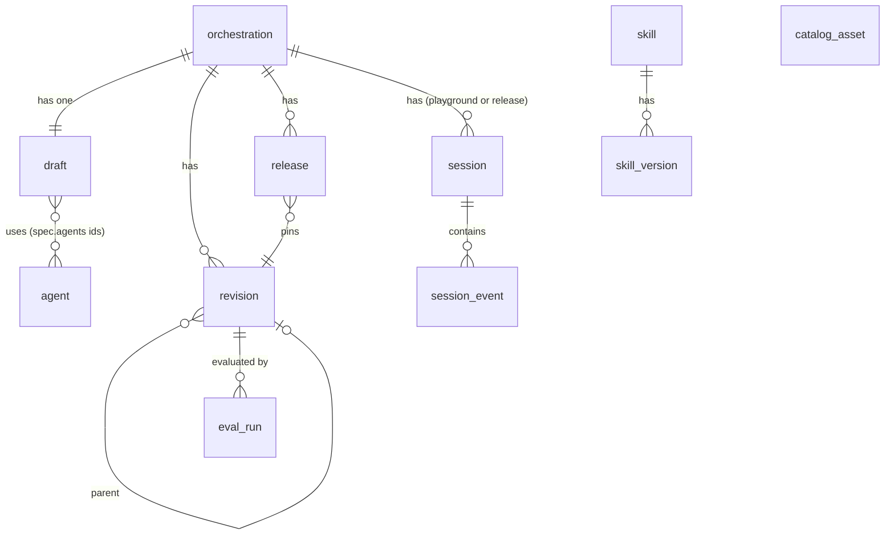
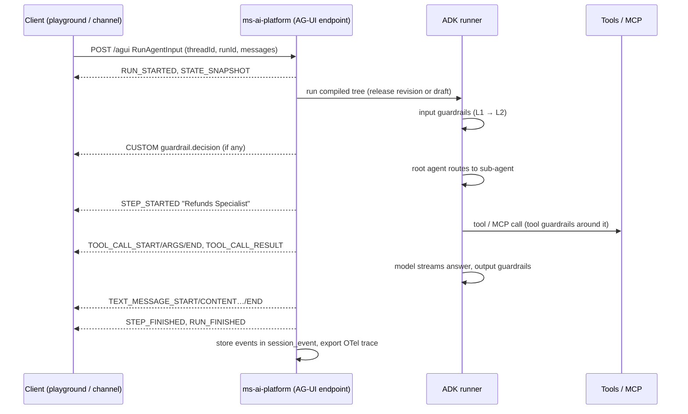

# Agentic Platform — Architecture

## 1. Goal

An internal platform where people across the company can **build, test, and run conversational AI agents** without writing code, using components that engineering teams build and vet.

There are two kinds of users:

| Persona | What they do | Where they work |
|---|---|---|
| **Builder** (end user: product, ops, CX, analysts) | Builds agents in a visual editor, combining instructions, skills, tools, MCP servers, guardrails, and an LLM, and connects agents into an orchestration. Tests in a playground, then publishes. | `web-ai-platform` |
| **Asset developer** (engineer) | Writes the technical pieces (tools, MCP contracts, guardrails) in Go, registers them, and ships them through code review. | `lib-agent-assets` |
| **Platform operator** (engineer) | Connects LLM providers and their credentials to the LLM gateway, and registers gateways with the platform. | `ms-llm-gateway`, `ms-ai-platform` config |

The main idea: **engineers write code once as *assets*, and builders combine those assets through configuration.** Builders never write code. Engineers never have to build each agent by hand.



### Design principles

1. **Code lives in assets. Configuration lives in the platform.** The platform stores *references* to assets (`kind/id@version` plus config values), never code.
2. **Specs are declarative and versioned.** An agent or orchestration is a JSON document. Each publish creates an immutable revision. The runtime builds a revision into a Google ADK agent tree.
3. **Single trunk first.** Each orchestration has one shared working draft and a linear history of revisions. Branching can be added later without changing the revision model.
4. **Standard agent ↔ UI protocol.** All runtime events (text streaming, tool calls, agent handoffs, state, guardrail decisions) go to the UI as **AG-UI** events. The frontend does not depend on ADK internals.
5. **Safe by default.** Guardrails and secrets are controlled centrally and enforced by the runtime, not by the UI.
6. **One language on the backend.** Go everywhere on the server side (assets, platform API, demo MCP). This keeps the asset SDK and the runtime in the same process and type system.

### 1.1 First release scope

| In the first release | Deferred |
|---|---|
| Asset SDK, registry, CLI, catalog sync | Branches, merge requests, 3-way merge |
| Visual builder (canvas + inspector) | Authentication and authorization (SSO, RBAC, per-team asset access) |
| Single trunk: shared draft + linear revisions | Approval workflows for releases |
| Releases per environment, rollback | Per-user audit trail (no user identity yet) |
| Playground and runtime over AG-UI | Delegated end-user tokens for MCP calls |
| L1 + L2 guardrails, OTel traces | Eval suites as a release gate |

> **No authorization in v1.** Everyone who can reach the platform can see and edit everything. The platform must therefore run **only on the internal network** (behind VPN / internal ingress), and must not be exposed to channels outside the company until authentication is added. The API is designed so that auth can be added later as middleware without changing the endpoints.

---

## 2. Repository layout

This is a monorepo. Each service is a top-level folder. The Go services share a `go.work` workspace so `ms-ai-platform` can use local `lib-agent-assets` changes during development.

```
agentic-platform/
├── ARCHITECTURE.md
├── go.work                 # lib-agent-assets, ms-ai-platform, ms-llm-gateway, demo-mcp, tools
├── lib-agent-assets/       # Asset SDK + registry + CLI (Go module)
├── ms-ai-platform/         # Platform API + agent runtime (Go)
├── ms-llm-gateway/         # OpenAI-compatible /v1 API in front of the LLM providers (Go)
├── web-ai-platform/        # Visual builder SPA (React)
├── demo-mcp/               # Example MCP server (Go)
├── tools/devrun/           # `make up`: runs dev.yaml services with live reload
├── deploy/                 # Helm charts / k8s manifests, docker-compose for local dev
└── docs/                   # ADRs, asset authoring guide, runbooks
```

---

## 3. Core concepts (shared vocabulary)

| Concept | Defined in | Description |
|---|---|---|
| **Asset** | `lib-agent-assets` | A code component with a manifest: `llm`, `tool`, `mcp`, `guardrail`. Identified by `{domain}.{kind}.{name}` and versioned with the module release. |
| **Asset manifest** | `lib-agent-assets` | Metadata (id, kind, domain, owner, description, icon, tags, lifecycle) plus a **JSON Schema** for its config. The UI renders config forms from this schema. |
| **Asset instance** | `ms-ai-platform` | A reference to an asset plus the config values a builder entered (e.g. guardrail `core.guardrail.pii-redact` with `{ "entities": ["email","cpf"] }`). |
| **Skill** | `ms-ai-platform` | A reusable, versioned package of instructions (Markdown) plus optional required tools. Builders write skills in the UI and attach them to agents. |
| **Agent** | `ms-ai-platform` | Instructions + LLM instance + skills + tools/MCP tools + guardrails. Agents live in a shared **agent library**, not inside one orchestration: the same agent can be used by many orchestrations, and editing it (on its own page or on any canvas) changes it everywhere. Each agent has its own version for optimistic concurrency. |
| **Orchestration** | `ms-ai-platform` | A *Conversation Orchestration*: a graph of library agents with one root agent, and the edges that say who delegates to whom. This is the unit that gets edited, released, and served to a channel. |
| **Draft** | `ms-ai-platform` | The single shared working copy of an orchestration's graph (the trunk head): which agents it uses, the root, edges, orchestration guardrails and layout. Edits autosave here; agent edits save to the library. |
| **Revision** | `ms-ai-platform` | An immutable snapshot of the full orchestration spec, created when the draft is published. Revisions form a linear history. |
| **Release** | `ms-ai-platform` | A revision promoted to an environment (`dev` → `staging` → `prod`). |
| **Session (thread)** | `ms-ai-platform` | One conversation with a released orchestration or with the draft (playground). Maps to an AG-UI `threadId`. Stores events and state. |
| **Run** | `ms-ai-platform` | One agent turn inside a session, from user input to final answer. Maps to an AG-UI `runId`. |

---

## 4. Services

### 4.1 `lib-agent-assets`

A Go module and registry that engineers use to make code components available to the platform. It is a **library, not a running service**: `ms-ai-platform` imports it, and a CLI validates it and exports its catalog.

**Tech stack:** Go, Google ADK for Go (`google.golang.org/adk`), JSON Schema (`invopop/jsonschema` to generate schemas from config structs).

#### Folder structure

```
lib-agent-assets/
├── cmd/
│   └── cli/                    # `assets` CLI: list, validate, export, test, scaffold
├── assets/
│   ├── core/                   # Cross-cutting assets, available to every domain
│   │   ├── guardrails/
│   │   ├── tools/
│   │   ├── mcps/
│   │   └── registry.go         # func Register(r *registry.Registry)
│   ├── {domain}/               # e.g. payments/, customer-care/, lending/
│   │   ├── guardrails/
│   │   ├── tools/
│   │   ├── mcps/
│   │   └── registry.go
│   └── registry.go             # Aggregates core + all domains: assets.New()
└── pkg/                        # The library other modules import
    ├── assets/                 # Asset interfaces, manifest types, JSON Schema helpers
    ├── registry/               # Registry type: registration, validation, lookup, model refs
    └── testkit/                # Conformance tests every asset must pass (planned)
```

> There is no checked-in catalog file: the Go code is the source of truth. `ms-ai-platform` builds the catalog from it at startup and syncs it to Postgres; `assets export` prints it as JSON when another tool needs it.

> Everything another module needs lives under `pkg/` and is a public library: `pkg/assets` to write assets, `pkg/registry` to hold a catalog of them (the platform also registers its LLM gateways there). The top-level `assets/` folder holds the assets themselves, and its `New()` returns a registry with all of them (import it with an alias, e.g. `allassets`, next to `pkg/assets`).

#### Asset contract

Every asset implements a common descriptor and one interface per kind:

```go
type Manifest struct {
    ID           string             // "payments.tool.refund-lookup"
    Kind         Kind               // llm | tool | mcp | guardrail
    Domain       string             // "core" | "payments" | ...
    Name         string
    Description  string             // shown in the UI and to the LLM (for tools)
    Owner        string             // team handle, e.g. "@payments-platform"
    Tags         []string
    Lifecycle    Lifecycle          // experimental | stable | deprecated
    ConfigSchema *jsonschema.Schema // generated from the Config struct
    Secrets      []SecretRef        // names of secrets the asset needs, never values
}

// LLM is implemented by the platform, not by lib-agent-assets: ms-ai-platform
// registers one per LLM gateway it connects to (see 4.2 and 4.5).
type LLM interface {
    Manifest() Manifest
    New(ctx context.Context, cfg json.RawMessage, s Secrets) (model.LLM, error)  // ADK model
}

type Tool interface {
    Manifest() Manifest
    New(ctx context.Context, cfg json.RawMessage, s Secrets) (tool.Tool, error)  // ADK tool
}

type MCP interface {
    Manifest() Manifest
    // Connection contract: transport, URL template, auth mode, allowed tools.
    Connection(cfg json.RawMessage) (MCPConnection, error)
}

type Guardrail interface {
    Manifest() Manifest
    Level() GuardrailLevel                    // L1 | L2
    Stages() []Stage                          // input | output | tool_call | tool_result
    New(ctx context.Context, cfg json.RawMessage, deps Deps) (Check, error)
}

type Check func(ctx context.Context, in GuardInput) (GuardResult, error)

type GuardResult struct {
    Action   Action   // allow | redact | block | escalate
    Redacted string   // when Action == redact
    Reason   string   // stored in the trace and sent to the UI as an AG-UI CUSTOM event
    Labels   []string // e.g. "prompt_injection", "pii.email"
}
```

#### Asset kinds

| Kind | Purpose | Notes |
|---|---|---|
| **llms** | Not shipped by lib-agent-assets: it holds no LLM connection details. `ms-ai-platform` registers one LLM per OpenAI-compatible gateway listed in its `config/llm-providers.yaml` (by default only `ms-llm-gateway`, as `core.llm.gateway`). Returns an ADK `model.LLM`. | Builders pick a gateway (hidden when there is only one), then a model from the list it serves on `GET /v1/models`, refreshed every minute. Guardrails reference models as `"<gateway>:<model>"`. |
| **tools** | Native Go functions exposed to agents as ADK tools. | Input/output are typed structs, and the LLM-facing schema is generated from them. Must declare side effects (`read` / `write`) so writes can require confirmation. |
| **mcps** | The contract for an MCP server: transport (streamable HTTP / SSE), URL per environment, auth mode (none, static token, OAuth2 client credentials, mTLS), and an **allow-list** of tools. | The platform discovers tools through `tools/list` and filters them with the allow-list. Builders choose tools from that filtered list. |
| **guardrails** | Policy checks that run around model and tool calls. | **L1**: deterministic and fast (regex, keyword lists, PII patterns, length limits, schema validation). Redact or block. **L2**: model-based (prompt-injection and jailbreak detection, topic/off-scope classification, toxicity, grounding checks). Has its own LLM instance and higher latency. |

#### Guardrail execution

Guardrails run as **ADK callbacks**, so any agent built by the platform enforces them the same way:

| Stage | ADK hook | Typical guardrails |
|---|---|---|
| `input` | `BeforeModelCallback` (and before the session's first user turn) | PII redaction (L1), prompt injection (L2) |
| `tool_call` | `BeforeToolCallback` | Argument validation, write confirmation, PII in arguments |
| `tool_result` | `AfterToolCallback` | Indirect prompt injection in retrieved content (L2) |
| `output` | `AfterModelCallback` | Leaked secrets/PII (L1), off-policy answer (L2) |

Execution order: all L1 checks first (cheap, short-circuit on `block`), then L2 checks in parallel. Guardrails can be attached at the **orchestration level** (applies to every agent) or at the **agent level**. Each environment can define **mandatory** guardrails in platform config (e.g. PII redaction in `prod`). The compiler always adds them, even if the spec does not include them.

#### Registration

```go
// assets/payments/registry.go
func Register(r *registry.Registry) {
    r.MustTool(tools.RefundLookup{})
    r.MustGuardrail(guardrails.CardNumberRedactor{})
    r.MustMCP(mcps.LedgerMCP{})
}

// assets/registry.go
func New() *registry.Registry {
    r := registry.New()
    core.Register(r)
    payments.Register(r)
    customercare.Register(r)
    return r
}
```

Registration is explicit (no `init()` side effects), which makes the catalog predictable and testable.

#### CLI (`cmd/cli`)

| Command | Description |
|---|---|
| `assets list [--kind] [--domain]` | Print the catalog |
| `assets validate` | Unique IDs, valid manifests, schemas compile, owners set, secrets declared |
| `assets export [-o file]` | Print every manifest as JSON (for other tools; nothing in the repo reads it) |
| `assets test <id>` | Run the asset against `testkit` conformance tests and its own fixtures |
| `assets new <kind> <domain> <name>` | Scaffold a new asset with tests |
| `assets run guardrail <id> --input "..."` | Try a guardrail locally |

#### Asset lifecycle and delivery



- **Versioning:** the module is released with semver. Asset IDs are stable. A breaking config change needs a new ID or a config migration function.
- **Deprecation:** `Lifecycle: deprecated` hides the asset from pickers but keeps existing agents working. The UI warns about affected agents. Removal is only allowed when no released revision references the asset (the catalog sync enforces this check).
- **Ownership:** each `assets/{domain}/` folder has a CODEOWNERS entry, and the manifest `Owner` must match it. (This is code-review ownership in the Git host, not platform authorization.)

> **Why compile in, not plug in?** Compiling assets into the platform binary gives type safety, no plugin ABI problems, and one deployable unit. The cost is that new assets need a platform deploy. If that becomes a bottleneck, tools can move to separate MCP servers (out of process, deployed on their own) without changing how builders use them.

---

### 4.2 `ms-ai-platform`

The backend. It stores agent and orchestration specs, manages the draft, revisions, and releases, exposes the asset catalog, and **runs** orchestrations with Google ADK, streaming results to clients as AG-UI events.

> The original note said "backstage application". This document reads that as **backend application** (Go). If it meant a **Backstage** (Spotify developer portal) plugin, see the open questions in section 9.

**Tech stack:** Go, Google ADK for Go, REST (OpenAPI 3.1, code generated with `oapi-codegen`) for resources, **AG-UI** over SSE for agent runs, Postgres (`pgx` + `sqlc`, migrations with `goose`), OpenTelemetry.

#### Internal structure

```
ms-ai-platform/
├── cmd/
│   ├── api/                # REST API + AG-UI endpoint + runtime (one binary)
│   └── migrate/
├── api/openapi.yaml        # Source of truth for the REST contract (also generates the TS client)
├── internal/
│   ├── catalog/            # Loads lib-agent-assets.All() + the LLM providers, syncs to Postgres
│   ├── llmconfig/          # config/llm-providers.yaml: the OpenAI-compatible gateways to use
│   ├── llmproviders/       # One LLM asset per gateway: model list refresh, ADK model over Chat Completions
│   ├── spec/               # Agent/Orchestration spec types, validation, JSON Schema
│   ├── versioning/         # Draft (optimistic concurrency), linear revisions, diff
│   ├── release/            # Environments, promotion, rollback
│   ├── compiler/           # Spec revision/draft -> ADK agent tree
│   ├── runtime/            # Session service, ADK runner, tool confirmation
│   ├── agui/               # AG-UI endpoint, ADK event -> AG-UI event translator, SSE encoder
│   ├── mcpclient/          # MCP connections, tool discovery, auth, connection pool
│   ├── secrets/            # Secret manager adapter (Vault / GCP SM / AWS SM)
│   ├── eval/               # Test cases and evaluation runs
│   └── store/              # sqlc queries, repositories
└── migrations/
```

#### Agent spec

Builders edit this document through the UI. It is stored as JSONB in the draft and in each revision.

```jsonc
{
  "id": "agt_refunds",
  "name": "Refunds Specialist",
  "type": "llm",                       // llm | sequential | parallel | loop (ADK workflow agents)
  "description": "Handles refund status and requests",  // used by the parent for routing
  "instructions": "You help customers with refunds...",
  "model": { "asset": "core.llm.gateway", "config": { "model": "claude-haiku/claude-haiku-5-5", "effort": "low" } },
  "skills": [ { "ref": "skl_refund_policy", "version": 3 } ],
  "tools": [
    { "asset": "payments.tool.refund-lookup", "config": {} },
    { "mcp": "payments.mcp.ledger", "tools": ["get_transaction", "list_refunds"] }
  ],
  "guardrails": [ { "asset": "core.guardrail.pii-redact", "config": { "entities": ["email", "cpf"] } } ],
  "subAgents": ["agt_escalation"],
  "outputSchema": null,
  "settings": { "maxTurns": 20, "requireConfirmationFor": ["write"] }
}
```

An **orchestration spec** contains the agents, the `rootAgent`, orchestration-level guardrails, a session-state schema (also used as the AG-UI shared state shape), a channel config, and UI layout (node positions on the canvas, kept separate from the runtime fields).

#### Compiler (spec → ADK)

For a given revision (or the current draft, for the playground), the compiler:

1. Resolves each asset reference against the catalog, and fails if an asset is missing or removed.
2. Gets secrets from the secret manager for the target environment.
3. Builds ADK objects: `llmagent` for `llm` agents, workflow agents (`sequential`, `parallel`, `loop`) for the others, with skills merged into the instructions, tools and MCP toolsets attached, sub-agents linked, and guardrail callbacks installed (including the environment's mandatory guardrails).
4. Caches the compiled tree by `(revisionId, environment)`. Revisions are immutable, so the cache is always valid for them. Draft builds are cached by `(draftVersion)` and thrown away when the draft changes.

Delegation between agents uses ADK's built-in transfer (sub-agents) or `AgentTool` (call another agent as a tool and get its result back). The builder chooses this on each edge in the canvas.

#### Single trunk: draft, revisions, releases

Each orchestration has **one trunk** and no branches in the first release:



- **Draft:** one shared working copy per orchestration. The UI autosaves edits to it. Every write sends the draft's current `version` (`If-Match` ETag). If someone else saved first, the API returns `409 Conflict` with the latest draft, and the UI shows what changed and lets the user reapply their edit. This is **optimistic concurrency**: there is no locking and no merging.
- **Publish:** creates an immutable revision from the draft, with a message and a free-text author name (there is no user identity in v1). Revisions are linear: each one has one parent.
- **History:** list revisions, view any revision, compare two revisions (per-agent, per-field diff), and **restore** an old revision into the draft.
- **Releases:** a release pins a revision to an environment (`dev`, `staging`, `prod`). Each environment has its own secrets, MCP endpoints, and mandatory guardrails. Promotion has no approval step in v1. Rollback re-points the environment to an earlier revision and is instant.
- Channels always call a **release**. Only the playground runs the draft.

> **Path to branching later:** the revision table already stores `parent_ids` as an array and the draft is keyed by orchestration. Adding branches means adding a `branch` table (name → head revision), one draft per branch, and merge revisions with two parents. Existing data becomes the `main` branch.

#### Runtime and AG-UI

Agent runs use the **[AG-UI protocol](https://docs.ag-ui.com)** (Agent–User Interaction Protocol). The client sends a `RunAgentInput` with HTTP POST, and the server answers with a stream of typed AG-UI events over **Server-Sent Events**. Both the playground in `web-ai-platform` and any future channel (web widget, internal apps) use the same endpoint and event format.

**Endpoint**

```
POST /v1/orchestrations/{id}/agui?target=draft            # playground
POST /v1/orchestrations/{id}/agui?target=release&env=prod # channels
Accept: text/event-stream
```

```jsonc
// RunAgentInput (AG-UI)
{
  "threadId": "ses_01H...",       // platform session id (created if it does not exist)
  "runId": "run_01H...",
  "messages": [ { "id": "m1", "role": "user", "content": "Where is my refund?" } ],
  "tools": [ { "name": "confirm_action", "description": "...", "parameters": { } } ], // frontend tools
  "state": { },                   // shared state from the client
  "context": [ ],
  "forwardedProps": { }
}
```

**ADK → AG-UI event mapping** (implemented in `internal/agui`):

| What happens in the run | AG-UI events |
|---|---|
| Run starts / ends / fails | `RUN_STARTED` · `RUN_FINISHED` · `RUN_ERROR` |
| An agent starts or hands off to another agent | `STEP_STARTED` / `STEP_FINISHED` with `stepName` = agent name |
| Model streams text | `TEXT_MESSAGE_START` → `TEXT_MESSAGE_CONTENT` (deltas) → `TEXT_MESSAGE_END` |
| Model calls a tool (native, MCP, or agent-as-tool) | `TOOL_CALL_START` → `TOOL_CALL_ARGS` → `TOOL_CALL_END` |
| Backend tool returns | `TOOL_CALL_RESULT` |
| ADK session state changes | `STATE_SNAPSHOT` (on start) and `STATE_DELTA` (JSON Patch) |
| Reconnect / history load | `MESSAGES_SNAPSHOT` |
| Guardrail decision | `CUSTOM` with `name: "guardrail.decision"` and `{ guardrailId, stage, action, reason, labels }` |
| Trace link, token usage | `CUSTOM` with `name: "trace"` / `"usage"` |

**Human in the loop (write confirmations):** confirmation uses AG-UI **frontend tools**. When a `write` tool needs approval, the runtime emits a tool call to the frontend tool `confirm_action` (with the tool name and arguments) and ends the run. The UI shows a confirm/deny card. Its answer comes back as a `tool` message in the next run on the same `threadId`, and the runtime then runs or skips the original tool.

**Other runtime details**

- The session service uses Postgres (an ADK `session.Service` implementation) for events and state. AG-UI `threadId` = platform session id, `runId` = one run.
- ADK events are stored once in `session_event`. AG-UI events are generated from them while streaming, so reconnecting or replaying a session gives the same events.
- Every run creates an OpenTelemetry trace with spans for agent turns, model calls (with token usage), tool and MCP calls, and guardrail decisions. The playground shows the trace next to the chat.
- Event types and the SSE encoder come from the AG-UI Go SDK if it fits our needs. Otherwise `internal/agui` holds a small encoder of our own: the event format is plain JSON, so this is low-risk.

#### REST API (overview)

REST covers resources and configuration. Agent runs go through the AG-UI endpoint.

| Area | Endpoints |
|---|---|
| Catalog | `GET /v1/catalog?kind=&domain=` · `GET /v1/catalog/{assetId}` (manifest + config schema) |
| MCP | `GET /v1/mcps/{assetId}/tools` (discovered tools, filtered by the allow-list) |
| Skills | `GET/POST /v1/skills` · `GET/PUT /v1/skills/{id}` · `GET /v1/skills/{id}/versions` |
| Agents | `GET/POST /v1/agents` · `GET/PUT/DELETE /v1/agents/{id}` (`PUT` with `If-Match`; `DELETE` is refused while orchestrations use the agent) · `POST /v1/agents/validate` |
| Orchestrations | `GET/POST /v1/orchestrations` · `GET/DELETE /v1/orchestrations/{id}` |
| Draft | `GET /v1/orchestrations/{id}/draft` (the graph plus the library agents it uses) · `PUT .../draft` (the graph, with `If-Match`) · `POST .../draft/validate` |
| Revisions | `POST .../revisions` (publish draft) · `GET .../revisions` · `GET .../revisions/{rev}` · `GET .../compare?base=&head=` · `POST .../revisions/{rev}/restore` |
| Releases | `GET/POST /v1/orchestrations/{id}/releases` · `POST .../releases/{env}/rollback` |
| Runtime | `POST .../agui` (AG-UI, SSE) · `GET .../sessions` · `GET .../sessions/{sid}/events` |
| Eval | `GET/POST .../eval-cases` · `POST .../eval-runs` · `GET .../eval-runs/{run}` |

The OpenAPI spec generates both the Go server stubs and the TypeScript client used by `web-ai-platform`. The AG-UI endpoint is listed in OpenAPI for discoverability, but clients use the AG-UI client library to consume it.

#### Data model (Postgres)



| Table | Key columns |
|---|---|
| `catalog_asset` | `id`, `kind`, `domain`, `manifest jsonb`, `config_schema jsonb`, `lifecycle`, `module_version`, `synced_at` |
| `orchestration` | `id`, `name`, `description`, `created_at` |
| `agent` | `id`, `spec jsonb` (name, instructions, model, skills, tools, guardrails), `version int`, `created_at`, `updated_at`, `updated_by_name` |
| `draft` | `orchestration_id` (PK), `spec jsonb` (the graph; `agents` holds library agent ids), `version int`, `based_on_revision_id`, `updated_at`, `updated_by_name` |
| `revision` | `id`, `orchestration_id`, `number int`, `parent_ids uuid[]` (one item in v1), `spec jsonb`, `spec_hash`, `author_name`, `message`, `created_at` |
| `release` | `orchestration_id`, `environment`, `revision_id`, `released_at`, `previous_revision_id` |
| `session` | `id` (= AG-UI `threadId`), `orchestration_id`, `target` (`draft` / `release`), `environment`, `revision_id`, `state jsonb` |
| `session_event` | `session_id`, `run_id`, `seq`, `author`, `type`, `payload jsonb`, `created_at` |

#### Security (v1)

- **No authentication or authorization** in the first release (see 1.1). The service is only reachable on the internal network. All handlers get a request context that has a place for a caller identity, so auth middleware can be added later without changing handlers.
- **LLM credentials** live only in `ms-llm-gateway` (env vars named in its `llms.yaml`). The platform holds at most a key for the gateway itself (`LLM_GATEWAY_API_KEY`), and the gateway can require one with `GATEWAY_API_KEYS`.
- **Secrets:** specs contain secret *references* only. Values are fetched at compile time per environment and are never returned by the API, sent in AG-UI events, or written to logs or traces.
- **MCP auth:** each MCP manifest says how the platform authenticates to the server (static token, client credentials, mTLS). Delegated end-user tokens come with platform auth.
- **Guardrails:** mandatory guardrails per environment are enforced by the compiler, so a builder cannot skip them even without access control.

---

### 4.3 `web-ai-platform`

The visual builder that builders use.

**Tech stack:** React SPA (Vite + TypeScript), Tailwind CSS, shadcn/ui, TanStack Query (server state), TanStack Router, React Flow / `@xyflow/react` (orchestration canvas), JSON Schema form renderer built on shadcn inputs (asset config forms), Monaco or a Markdown editor (instructions and skills), generated OpenAPI TypeScript client, **`@ag-ui/client`** (`HttpAgent`) for agent runs.

#### Layout

```
┌──────────────┬──────────────────────────────────────────────────────────────┐
│ ◀            │  Orchestration: Customer Care   ● Saved (draft v42)  Publish│
│──────────────│──────────────────────────────────────────────────────────────│
│ ▸ Orchestr.  │                                                              │
│ ▸ Agents     │      ┌─────────┐        ┌──────────────┐                     │
│ ▸ Skills     │      │ Router  │──────▶ │ Refunds      │──▶ [ledger MCP]     │
│ ▸ Tools      │      └─────────┘        └──────────────┘                     │
│ ▸ MCPs       │           │                                                  │
│ ▸ Guardrails │           └───────────▶ ┌──────────────┐                     │
│ ▸ LLMs       │                         │ Escalation   │                     │
│──────────────│                         └──────────────┘                     │
│ ▸ History    │──────────────────────────────────────────────────────────────│
│ ▸ Releases   │  Inspector (selected node)        │  Playground (chat+trace) │
│ ▸ Evals      │                                    │                          │
└──────────────┴──────────────────────────────────────────────────────────────┘
```

- **Left sidebar (collapsible to icons):** Orchestrations, Agents, Skills, Tools, MCPs, Guardrails, LLMs, History, Releases, Evals. The Tools, MCPs, Guardrails, and LLMs sections show the **asset catalog** as read-only cards: description, owner, lifecycle badge, config schema, and which agents use the asset.
- **Canvas:** agents are nodes. Edges are delegation (`sub-agent` or `agent-as-tool`). Right-click the canvas to add a new agent or an existing one from the library at the cursor; right-click an agent to edit it, open its page, make it root or remove it from the orchestration (it stays in the library); right-click an edge to switch its mode or remove it. Tools, MCPs, and guardrails can be dragged from the sidebar onto an agent node.
- **Inspector:** forms for the selected agent (instructions editor, model picker, skills, tools with MCP tools selected per server, guardrails) or the selected connection (mode, remove). Asset config forms are **generated from the asset's JSON Schema**, so new assets show up in the UI with no frontend changes. The same agent form is used on the agent's own page (`/agents/{id}`), which also shows the orchestrations that use it.
- **Top bar:** draft save status and version, validation errors, and a **Publish** button (asks for a message and author name). On a `409 Conflict`, it shows a "draft changed by someone else" banner with a diff and a reload/reapply action.
- **History:** linear list of revisions, a diff between any two, and "restore into draft".
- **Playground:** an AG-UI client (`HttpAgent`) pointed at `.../agui?target=draft`. It renders events as they arrive:
  - text message events → chat bubbles with streaming text
  - `STEP_*` → "Router → Refunds Specialist" handoff markers, and highlights the active agent on the canvas
  - `TOOL_CALL_*` → collapsible tool call cards with args and results
  - `confirm_action` frontend tool → confirm/deny card for write tools
  - `CUSTOM guardrail.decision` → guardrail badges (redacted / blocked, with reason)
  - `STATE_*` → a live session-state panel
  - `CUSTOM trace` / `usage` → trace link and token counts
- **Releases:** one column per environment showing the pinned revision, with promote and rollback.

> CopilotKit (a React UI library built on AG-UI) is an option for chat components. The first release uses our own shadcn components on top of `@ag-ui/client`, so the playground can show platform-specific events (handoffs on the canvas, guardrail badges, traces).

---

### 4.4 `demo-mcp`

An example MCP server for local development, demos, and as a reference implementation for teams that build their own MCP servers.

**Tech stack:** Go, official MCP Go SDK (`github.com/modelcontextprotocol/go-sdk`), streamable HTTP transport.

- **Example tools:** `get_weather(city)`, `lookup_order(order_id)` (fake data), `create_ticket(subject, body)` (a *write* tool that shows the AG-UI confirmation flow), and `search_faq(query)`.
- Includes a matching asset in `lib-agent-assets/assets/core/mcps/demo.go` (the contract plus the tool allow-list), so it shows up in the catalog from start to finish.
- Optional static bearer-token auth to show how MCP auth modes work.
- Health check at `/healthz`. Runs in `docker-compose` next to the platform.

### 4.5 `ms-llm-gateway`

A small Go service that puts every LLM provider behind **one OpenAI-compatible API**. `ms-ai-platform` only speaks OpenAI Chat Completions to it, so provider credentials, protocols and model lists stay out of the platform and out of `lib-agent-assets`.

**Tech stack:** Go, official Anthropic Go SDK for Claude, plain HTTP passthrough for OpenAI-compatible upstreams.

- **Config:** `config/llms.yaml` (embedded; `LLM_CONFIG_PATH` overrides it). Each provider has a `type` (`anthropic` or `openai`), optional `baseURL` and `headers` (`${VAR}` expanded per request), `apiKeyEnv` (the *name* of the env var with the key; literal keys are rejected), `models` (labels, the default, which accept reasoning effort), `params`, and for OpenAI-compatible upstreams optional `discover` (`GET /models` with include/exclude globs, refreshed every `refresh`, 5 minutes by default). `defaults.model` marks the gateway's default model.
- **API:**
  - `GET /v1/models`: every model as `"<provider>/<model>"` (for example `claude-haiku/claude-haiku-5-5`), with `display_name` and `default` extensions.
  - `POST /v1/chat/completions`, streaming or not: messages, tools, `tool_choice`, `parallel_tool_calls`, `max_tokens` / `max_completion_tokens`, `stop`, `reasoning_effort`, `stream_options.include_usage`. Unsupported options (`n > 1`, images, `response_format` on Claude) get a clear 400.
  - `GET /healthz`: per provider, whether its key is set, model count and discovery status. No secrets.
- **Anthropic adapter:** translates Chat Completions to the Messages API and back, including stream events (text, tool-call argument fragments, usage, finish reasons) and `reasoning_effort` → `output_config.effort` for models that support it.
- **Reasoning extension:** Claude's signed thinking blocks travel as `reasoning_content` + `thinking_blocks` on responses, and are sent back on assistant messages (the same convention LiteLLM uses). This keeps tool loops valid when Claude thinks. They are stripped before reaching OpenAI-compatible upstreams.
- **OpenAI-compatible upstreams:** the body is forwarded with the model id rewritten, the key and headers injected, and fields the upstream may not accept removed; responses stream back unchanged.
- **Errors** use the OpenAI shape. A missing or invalid upstream key is a 502 that names the env var; rate limits pass through as 429.
- **Auth:** optional; `GATEWAY_API_KEYS` (comma-separated) makes `/v1/*` require `Authorization: Bearer`. Off by default, like the rest of v1.
- **Logs:** one line per call with provider, model, stream, status, duration and token counts. Message content is never logged.

On the platform side, `ms-ai-platform/config/llm-providers.yaml` lists the gateways to use (`LLM_PROVIDERS_PATH` overrides it). The default entry is this gateway at `${LLM_GATEWAY_URL:-http://localhost:8082/v1}`; more OpenAI-compatible gateways (LiteLLM, a company gateway) can be added next to it, each becoming its own LLM in the catalog.

---

## 5. Key flows

### 5.1 Engineer publishes a new asset
1. `assets new tool payments refund-lookup` creates the code and tests.
2. Implement it and run `assets validate` and `assets test`.
3. Open a PR. CI validates it and CODEOWNERS approve it. Merge and tag a release.
4. `ms-ai-platform` updates the dependency and deploys. Catalog sync upserts the asset into Postgres.
5. Builders see it in the sidebar and pickers.

### 5.2 Builder creates and ships an agent
1. Open the orchestration. The canvas loads the draft.
2. Add an agent on the canvas, write instructions, choose a model, attach a skill, MCP tools, and a guardrail. Changes autosave to the draft.
3. Test in the playground (draft preview over AG-UI). Look at handoffs, tool calls, guardrail decisions, and traces.
4. Publish the draft as a new revision.
5. Release the revision to `staging`, test, then release it to `prod`. Roll back if needed.

### 5.3 Runtime request



---

## 6. Non-functional requirements

| Area | Target / approach |
|---|---|
| Latency | L1 guardrails < 10 ms. L2 guardrails run in parallel with a timeout budget and a configured fail-open or fail-closed behavior per guardrail. First AG-UI event (`RUN_STARTED`) is sent right away so the UI responds quickly. |
| Streaming | SSE connections send heartbeats. Proxies and ingress must turn off response buffering for the AG-UI endpoint. |
| Scalability | API and runtime are stateless (state lives in Postgres) and scale horizontally. The runtime can run as its own deployment using the same binary. |
| Reliability | Revisions are immutable, rollback is instant, and MCP calls have timeouts, retries, and circuit breakers. |
| Observability | OTel traces, metrics (tokens, cost, latency, guardrail block rate per agent), and structured logs with PII redacted. |
| Cost control | Token budgets per orchestration, model allow-lists per environment (platform config), usage dashboards. |
| Compliance | Configurable data retention for sessions, mandatory PII guardrails in prod. Per-user audit comes with authentication. |

---

## 7. Local development

- `make up` starts Postgres (Docker) and runs `ms-llm-gateway`, `demo-mcp`, `ms-ai-platform` and the `web-ai-platform` Vite dev server with live reload. `tools/devrun` reads `dev.yaml`, rebuilds and restarts a Go service when its files change, and keeps the previous build running when a build fails. `docker-compose --profile full` can also run the backend services in containers.
- `go.work` links `lib-agent-assets` into `ms-ai-platform`, so local asset changes show up after a restart.
- A seed script creates an example orchestration that uses the demo MCP.
- The AG-UI endpoint can be tried without the UI: `curl -N -X POST .../agui -H 'Accept: text/event-stream' -d @run.json`.

---

## 8. Roadmap

| Phase | Scope |
|---|---|
| **Slice 0** (built) | lib-agent-assets SDK + CLI with current-time tool, demo MCP, L1 PII redaction and L2 prompt-injection guardrails; demo-mcp; catalog sync; one shared draft per orchestration with optimistic concurrency; React Flow canvas + inspector; AG-UI playground (draft only); ms-llm-gateway (Claude + OpenAI-compatible upstreams) with the platform registering one or more gateways. See README.md for what is in and out. |
| **MVP** | Publish + linear revisions and history, Postgres session store, traces in the playground |
| **Production** | Environments, releases and rollback, mandatory guardrails, L2 guardrails, AG-UI endpoint for channels on the internal network |
| **Access control** | SSO (OIDC), RBAC (viewer, builder, releaser, admin), per-team asset access, release approvals, audit log, delegated end-user tokens for MCP |
| **Collaboration** | Branches with per-branch drafts and previews, merge requests, 3-way merge, presence |
| **Quality** | Eval cases and eval runs as a release gate, cost dashboards |
| **Extensibility** | Out-of-process assets through MCP, memory/RAG assets, A2A (agent-to-agent protocol) for agents across platforms |

---

## 9. Open questions

1. **"Backstage application":** does `ms-ai-platform` need to be a **Backstage** plugin (TypeScript, inside the developer portal), or is it a standalone Go backend as described here? A middle option: a Backstage plugin that only *displays* the asset catalog, with the Go backend as the source of truth.
2. **Skills as assets:** should engineers also be able to ship skills from `lib-agent-assets` (e.g. compliance-approved policy text), or are skills only written in the UI?
3. **LLM providers:** which providers and hosting (Vertex AI, Bedrock, Anthropic API, self-hosted) are approved for each data classification?
4. **Channels:** which channels are needed first (web widget, WhatsApp, Slack, internal API)? Non-AG-UI channels (WhatsApp, Slack) would need adapters that consume the AG-UI stream and post the final messages.
5. **Secret manager:** Vault, GCP Secret Manager, or AWS Secrets Manager?
6. **AG-UI Go SDK:** use the AG-UI Go SDK, or keep our own small encoder in `internal/agui`? This depends on how mature the SDK is when implementation starts.
7. **Concurrent editing on the trunk:** is optimistic concurrency (409 + reapply) enough for v1, or do teams need live co-editing on the canvas?
